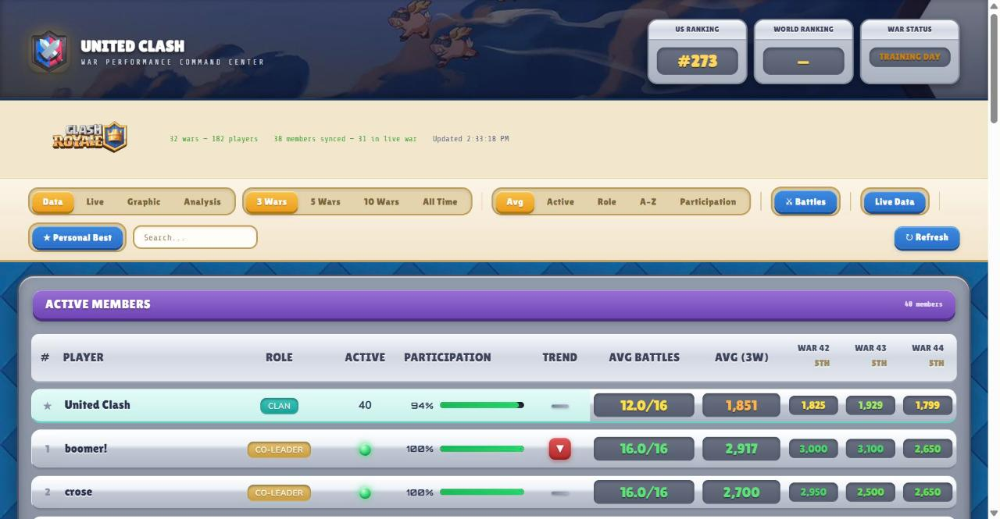

# United Clash Dashboard

A war-performance dashboard I built for my 50-member Clash Royale clan. It tracks every player across every clan war, shows the current war live, and recommends who to promote, demote, or remove based on a scoring model I designed with the clan's leaders.

**Live:** [unitedclash.pages.dev](https://unitedclash.pages.dev) · works on phone and desktop, installable as an app



## Why I built it

Running a 50-person clan meant making promotion and kick decisions from memory and gut feel, and the in-game stats only show the current war. I wanted a history of who actually shows up, war after war, and a fair, consistent way to make roster decisions. After release, the leadership team started using its recommendations for promotions and kicks.

## What it does

**Data tab:** a sortable table of every member with a war-by-war heatmap of fame, battles used, participation, and trend.

**Live tab:** the active war in real time. Four day columns, battles used out of 200 per day, a projection of where the clan will finish, and a "reviewing last war" mode once a war ends.

**Graphic tab:** SVG charts of clan fame per war and average fame per player, plus expandable charts for each player.

**Analysis tab:** a value score for every member that drives promotion and demotion signals, with tenure requirements before anyone can move up.

## How it works

```
Clash Royale API ──► Google Apps Script (runs on a schedule) ──► Google Sheet (war history + live snapshots)
        │                                                                 │
        └──► Cloudflare Worker proxy (holds the API key) ──┐              │
                                                           ▼              ▼
                                         Static dashboard on Cloudflare Pages (HTML/CSS/JS)
```

1. A **Google Apps Script** ([`apps-script/Code.gs`](apps-script/Code.gs)) polls the Clash Royale API on a schedule, finalizes finished wars into history tables, and snapshots the live war about every 15 minutes.
2. The dashboard reads that history from the Google Sheet's CSV export and pulls live data through a **Cloudflare Worker proxy**, so the API key never reaches the browser.
3. The front end is plain HTML, CSS, and JavaScript with no build step, deployed as static files on Cloudflare Pages.

## Design decisions

**Reliability over raw fame.** The value score weights fame per war (25%), fame per battle (15%), participation (20%), battles actually used (20%), and tenure (20%). An earlier version was 60% fame, which ranked consistent-but-modest players too low, so I reweighted it toward showing up.

**Rank-based tiers with tenure gates.** Members are ranked by value score and split into thirds (Co-Leader, Elder, Member tiers). Elder requires 8 qualifying wars and Co-Leader requires 15, so a new player can't jump ahead on one good week.

**One source of truth for every number.** Scoring (`calcValueScore`) and war placement (`getAdjustedRank`) each live in exactly one function used everywhere, after I found the same formula drifting in two places.

**Handling the messy cases.** Placement ties at the 10,000-fame finish line show as a shared first place, members kicked mid-war still count toward that day's battles, and the 50-player roster cap only trims empty padding, never real contributors.

**Refactored for maintainability.** The app started as a single 4,500-line `index.html`. I split it into separate files for data parsing, calculations, and each tab, and separated calculation from rendering, without adding a build step.

## How I built it

I designed the dashboard, the data pipeline, and the scoring model, and built it with Claude Code as my pair programmer, which wrote much of the implementation while I directed the design, tested against real war data each week, and worked with the clan's leaders on what the recommendations should be. [`CLAUDE.md`](CLAUDE.md) holds the project notes I kept for those sessions.

## Project structure

```
index.html          page shell and styles
manifest.json       app manifest (installable on phones)
service-worker.js   offline caching
js/config.js        data sources, clan tag, scoring weights and thresholds
js/state.js         shared app state
js/parse.js         CSV and API parsing
js/calculations.js  scoring, placement, and analytics
js/tab-*.js         one file per tab (data, live, graphic, analysis)
js/main.js          startup and event handlers
apps-script/        Google Apps Script that collects war data (API key not included)
assets/             backgrounds and icons
```

## Running it

It's a static site, so you can serve the folder with any static server (for example `npx serve .`) and open it in a browser. To deploy, upload the folder to Cloudflare Pages. To use it for a different clan, change `CLAN_TAG` and `SHEET_ID` in `js/config.js` and set up the Apps Script with your own API key.

---

*This material is unofficial and is not endorsed by Supercell. For more information see Supercell's Fan Content Policy: www.supercell.com/fan-content-policy. Game images in `assets/` belong to Supercell.*
